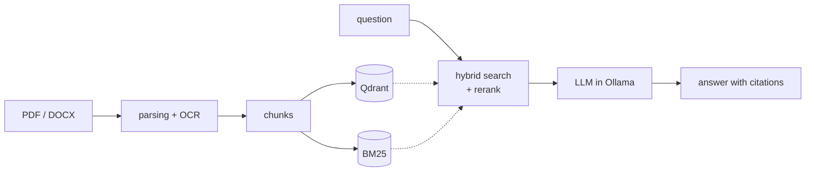

# nsu-rag-llm

Question answering over NSU FIT course materials: it answers from the course
books and backs every statement with a link `[course · «document» · p. 34]`.

[Русский](README.md) · **English**

## Why

There are a lot of course books and they are scattered: dozens of PDFs, some
of them scans. Finding where exactly a semaphore or Bayes' formula is
explained takes time, and a ChatGPT answer without a source cannot be checked.
Here the answer is built only from the course materials, and every sentence
opens on the right page.

## Features

- parses PDF and DOCX, scans go through OCR: 59,630 pages, 22 courses
- hybrid search: BM25 + embeddings, RRF fusion, cross-encoder rerank
- answers with page citations, in the terminal, as JSON and streamed (SSE)
- agent: picks the course, rewrites the query, refuses when nothing is found
- an LLM judge for answers, calibrated against manual labels
- everything runs locally on Ollama, no external APIs

## How it works



| Search | Latency on M3 Air |
|---|---|
| BM25 | ~1 ms |
| embeddings (multilingual-e5) | ~70 ms |
| hybrid | ~50 ms |
| hybrid + rerank | ~4 s |

The course materials themselves are not in the repository: they are other
people's copyrighted texts.

## Stack

Python 3.14 · uv · Qdrant · Ollama (Qwen) · LangGraph · sentence-transformers · pymupdf4llm · docling · FastAPI · Typer · pytest

## Structure

```
src/nsu_rag_llm/
  ingest/       inventory, parsing, OCR, chunking, indexing
  retrieval/    BM25, embeddings, RRF, rerank
  generation/   prompt, LLM, citation checks
  agent/        routing and repeated search
  evaluation/   retrieval metrics and the LLM judge
  api/          HTTP API
  cli.py        nsu-rag commands
eval/           question and label templates
ollama/         Modelfiles for the models
tests/          tests, everything external is faked
```

## Run

```bash
ollama pull qwen3.5:9b && ollama create qwen3.5-9b-8k -f ollama/Modelfile
uv sync --extra ml --extra ingest
docker compose up -d qdrant
cp .env.example .env

uv run nsu-rag parse && uv run nsu-rag ingest
uv run nsu-rag ask "What is the difference between a process and a thread?"
```

HTTP API: `uv run uvicorn nsu_rag_llm.api.main:app`, then `POST /ask` or `/ask/stream`.
Tests: `uv run pytest`.

P.S. For now it runs locally on localhost.
