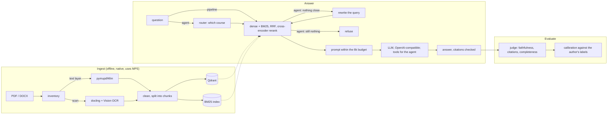

# nsu-rag-llm

RAG question answering over the course materials of NSU FIT (Novosibirsk State
University, Faculty of Information Technologies). You ask a question, the
service finds the relevant pages of the relevant handbook and answers from
them, citing every claim as `[course · «document» · p. 34]`.

> **Status: all phases built.** Inventory, parsing and OCR, chunking and
> incremental indexing, four retrieval modes, cited answers (terminal, JSON,
> Server-Sent Events), an agent with routing, re-querying and tools, an LLM
> judge with calibration against the author's labels, and a model comparison
> are in place, tested and documented in 32 decision records. What is still
> missing is the author's own evaluation questions and labels - the quality
> numbers below wait for them; cost and speed are measured.

> **The course materials themselves are not distributed with this repository.**
> They are third-party copyrighted works. `data/` is git-ignored in full, and
> no excerpt from it appears in tests, reports or examples.

## Architecture



## Requirements

- macOS or Linux, Python 3.14, [uv](https://docs.astral.sh/uv/)
- Docker (Qdrant, and optionally the API)
- [Ollama](https://ollama.com) running natively on the host — on macOS a
  container has no access to Metal, so the model must not live in Docker

## Getting started

```bash
# 1. The answering model, with the context window pinned to 8192 tokens
ollama pull qwen3.5:9b
ollama create qwen3.5-9b-8k -f ollama/Modelfile

# 2. Python environment. The search models (ml) and OCR/DOCX (ingest) are
#    extras: the default install is what CI and the lean API image need.
uv sync --extra ml --extra ingest

# 3. Qdrant
docker compose up -d qdrant

# 4. Configuration
cp .env.example .env

# 5. Check that everything answers
uv run nsu-rag health
```

To run the API in a container as well, build the index natively first (the
sections below), then `docker compose up --build`. The image carries the
search models on the CPU - hybrid search, the reranker off, since a
cross-encoder on a CPU is too slow - mounts `data/` read-only, downloads the
models into a volume on the first question, and reaches the host's Ollama at
`http://host.docker.internal:11434/v1` (ADR-032).

### Surveying the corpus

```bash
uv run nsu-rag inventory                # pages, text layer, language, copies
uv run nsu-rag inventory --benchmark    # also times OCR and embedding
```

Writes `data/inventory.md` and refreshes `data/courses.yaml`, preserving the
course titles and `include` flags already in it. The benchmark needs the
optional extras: `uv sync --extra ingest --extra ml`.

### Parsing

```bash
uv run nsu-rag parse                    # what courses.yaml includes
uv run nsu-rag parse --course os        # one course
uv run nsu-rag parse --force            # ignore the cache
```

Each document becomes `data/parsed/<sha256>/`: the parser's raw output, the
cleaned pages that indexing reads, and a `document.md` to read by eye.
`data/parse-report.md` lists the pages worth checking by hand. A second run
parses nothing; cleaning is redone from the cache every time.

PDFs go through `pymupdf4llm`'s layout model. Display formulas become a
`[формула]` marker, because a PDF text layer cannot carry them - unless the
"formula" is really a paragraph of prose, which is kept; code listings are
rebuilt line by line into fenced blocks; check marks and arrows set in symbol
fonts are restored. Quality is judged against each page's own text layer:
on pages without formulas the parser keeps a median of 100% of it. Why, with measurements:
ADR-011…019 in [docs/decisions.md](docs/decisions.md).

### Chunking and indexing

```bash
docker compose up -d qdrant
uv sync --extra ml                      # sentence-transformers, torch
uv run nsu-rag ingest                   # chunk, embed what is new, drop what is gone
uv run nsu-rag ingest --dry-run         # chunk and report only
```

Chunks follow the book's headings, but a heading starts a new chunk only once
the current one holds enough text: heading levels differ from book to book,
and a fifth of sections are shorter than a sentence or two. Listings and tables
are never cut mid-line or mid-row, and every chunk fits the embedding model's
512-token window together with its "course › document › section" line. A
chunk's id is derived from its content, so a second run embeds nothing and an
edit re-embeds only the chunks it touched. `data/chunks.jsonl` holds every
chunk for keyword search (BM25); `data/ingest-report.md` has the numbers.

### The full corpus

The MVP index holds five courses' born-digital documents. Everything else -
the other courses, English documents, and the scans, OCR'd - goes into an
index of its own, so that the same questions can be asked of both
(`corpus.full.env` sets the scope, the chunks file and the collection):

```bash
uv sync --extra ml --extra ingest
uv run --env-file corpus.full.env nsu-rag ocr --status     # how far the OCR has got
uv run --env-file corpus.full.env nsu-rag ocr              # hours; stop and restart at will
uv run --env-file corpus.full.env nsu-rag parse
uv run --env-file corpus.full.env nsu-rag ingest
uv run --env-file corpus.full.env nsu-rag eval --stage retrieval   # -> <date>-retrieval-full.md
```

OCR runs page by page and appends every page to the cache as it is done, so
an interrupted run loses at most one page; `parse` then cleans the recognised
documents with the rest (ADR-030).

The full corpus is 145 unique documents, 59 630 pages, 22 courses - 130 483
chunks - and 20 040 of those pages went through OCR in 7.9 hours without a
single failed page; Intel's x86 manual alone is 8% of the pages. Asked the
same questions as the MVP index, it kept 70% of their top ten - the rest
mostly the newly recognised textbooks of the same courses - and the giant
manuals took none of those places: search stays in the language of the
question, so the English manuals answer English questions and questions
naming an instruction, and are left alone by the rest (ADR-030).

### Searching

```bash
uv run nsu-rag search "Чем процесс отличается от потока?"            # hybrid+rerank
uv run nsu-rag search "fork" --mode bm25 --course os --k 5
```

| mode | what it does | latency on an M3 Air |
|---|---|---|
| `bm25` | keyword search, Russian and English words each stemmed by Snowball | ~1 ms |
| `dense` | multilingual-e5 query embedding, nearest chunks in Qdrant | ~70 ms |
| `hybrid` | both, fused by Reciprocal Rank Fusion | ~50 ms |
| `hybrid+rerank` | hybrid's top 30 re-read by the `bge-reranker-v2-m3` cross-encoder | ~4 s |

`RERANKER_ENABLED=false` turns the reranker off everywhere.

### Evaluating retrieval

The author writes `eval/questions.jsonl` (format and advice: `eval/README.md`);
nothing in this repository generates questions.

```bash
uv run nsu-rag eval --stage retrieval --validate-only
uv run nsu-rag eval --stage retrieval       # recall@5, recall@10, MRR@10 for all four modes
```

A hit is a chunk from the gold document whose pages overlap the gold pages;
documents are matched by content hash, so naming any copy of a duplicate
works. The report, `eval/reports/<date>-retrieval.md`, breaks the metrics down
by course, by where the text came from (born-digital, a scan's own OCR layer,
or this project's OCR) and by question type, and holds only question ids and
numbers.

### Asking

```bash
uv run nsu-rag ask "Чем процесс отличается от потока?"
uv run nsu-rag ask "Что такое семафор?" --course os
```

The answer is printed as it is generated, each claim followed by its
citation, `[<course> · «<document>» · с. N]`. Then come the sources it cites,
anything wrong with its citations, and how long each stage took:

```
Источники (процитировано 5 из 10):
  Ф1  [<course> · «<document>» · с. 34]  <course>/sem4/<file>.pdf
  …
поиск 107 мс · реранк 4146 мс · первый токен 40.6 с (из них модель читала промпт 36.4 с) · весь ответ 52.7 с
промпт 4494 ток. (оценка 4504) · ответ 183 ток., 15.2 ток/с
```

What happens in between:
* hybrid search, reranked; the best 10 fragments go into the prompt, labelled
  `[Ф1]`…`[Ф10]` - as many as fit the 8 192-token window once 1 024 are kept
  for the answer. The prompt is measured with the model's own tokenizer
  before it is sent, and a fragment that does not fit is logged (ADR-024);
* the model cites labels; the code checks each one and writes the full
  citation, so a title or a page number is never invented. A label with no
  fragment behind it is reported as an error (ADR-025);
* when the handbooks do not answer, the answer is «В методичках этого нет.»,
  and when search finds nothing the model is not asked at all (ADR-026).

### Evaluating answers and choosing the model

```bash
ollama create qwen3.5-4b-8k -f ollama/Modelfile.qwen3.5-4b     # the other candidates,
ollama create gemma4-12b-8k -f ollama/Modelfile.gemma4-12b     # 8k context each
uv run nsu-rag eval --stage generation     # every model in eval/models.yaml, judged
uv run nsu-rag eval --stage judge          # the judge against your own labels
```

Every question is searched once and every model answers from the same
fragments, alone in memory. A judge model (`JUDGE_*`, its own endpoint) then
reads each answer twice: against the fragments - is every claim there, does
every citation support its claim - and against your reference answer - is
anything missing. Citations of fragments that do not exist and refusals are
counted by code, not by the judge (ADR-028). The report,
`eval/reports/<date>-generation.md`, has per model: faithfulness,
completeness, valid and supported citations, refusals on unanswerable
questions, false refusals, time to first token, tokens per second and peak
memory; answers and verdicts stay in `data/eval-runs/`.

How far to trust the judge is measured, not assumed: label some answers
yourself in `eval/manual_labels.jsonl` (format in `eval/README.md`), and
`--stage judge` reports agreement and Cohen's kappa for each verdict.

### The agent

```bash
uv run nsu-rag ask "Сколько сочетаний из 10 по 3?" --agent
uv run nsu-rag eval --stage agent        # phase 3 pipeline against the agent
```

A LangGraph graph around the phase 3 pipeline: a router picks the course and
filters the search; when the reranker finds nothing close enough, the
question is rewritten and searched again, and otherwise refused without
generating; while answering, the model may call `python_calc` (safe
arithmetic, no `eval`) and `search_course_materials` (ADR-031). The API takes
`"agent": true` in the body of `/ask` and `/ask/stream`.

### The HTTP API

```bash
uv run uvicorn nsu_rag_llm.api.main:app
curl -s localhost:8000/health | python3 -m json.tool
curl -s localhost:8000/ask -H 'content-type: application/json' \
     -d '{"question": "Чем процесс отличается от потока?", "course": "os"}' | python3 -m json.tool
curl -N localhost:8000/ask/stream -H 'content-type: application/json' \
     -d '{"question": "Чем процесс отличается от потока?"}'
```

* `/health` probes Qdrant and the LLM endpoint concurrently and answers `503`
  when either is down, naming the one that broke.
* `/ask` returns the answer, every fragment the model read (`sources`), which
  of them it cites, citation errors, token counts and stage timings.
* `/ask/stream` sends the same as Server-Sent Events: `sources` first, then
  `token` events with citations already expanded, then `done` - or `error` if
  something fails mid-answer (ADR-027).
* `"agent": true` in the body answers with the agent instead (ADR-031).
* The first question loads the models, about 20 s natively; `/docs` has the
  schema.

## Configuration

Every setting is an environment variable, and `.env.example` lists all of them
with their defaults. See [src/nsu_rag_llm/config.py](src/nsu_rag_llm/config.py).
Sampling parameters are configuration rather than baked into the Modelfile, so
that phase 4 can compare models under identical sampling.

## Results

| Retrieval mode | recall@5 | recall@10 | MRR@10 |
|---|---|---|---|
| BM25 | _author's questions_ | | |
| dense | | | |
| hybrid (RRF) | | | |
| hybrid + rerank | | | |

| Generating model | faithfulness | completeness | citations | refusal | TTFT | tok/s | peak RAM |
|---|---|---|---|---|---:|---:|---:|
| `qwen3.5-4b` | _author's questions_ | | | | 31.3 s | 10.1 | 3.25 GB |
| `qwen3.5-9b` (default) | | | | | 50.5 s | 6.1 | 5.62 GB |
| `qwen3.5-9b`, thinking | no answer: the 3 072-token budget went on thinking | | | | - | - | 5.62 GB |
| `gemma4-12b` | | | | | 79.1 s | 4.0 | 7.83 GB |

Cost measured on ad-hoc questions, every model on the same fragments, in one
run on a laptop that was slow that hour: the same `qwen3.5-4b` took 18.3 s to
its first token that morning (22.6 tok/s). Compare within the table, not with
other runs (ADR-029).

## Limitations

* **Pointed questions only.** Top-k retrieval brings ten fragments; "summarise
  the whole course" or "list every theorem in chapter 3" needs the whole
  course in view, which no top-k search provides.
* **OCR'd pages answer worse.** Recognition errors reach the fragments the
  model reads; the retrieval report breaks recall down by where the text came
  from, so the gap is measured rather than guessed.
* **Formulas.** Where the parser could not extract a formula it leaves
  `[формула]` (ADR-012), and the model is told not to reconstruct it - but in
  the phase 3 smoke run it once wrote out a (correct) formula its fragments did
  not contain. The judge counts that as unfaithful.
* **Latency on a 16 GB laptop.** The model server and the search process take
  about 13 GB between them; with other applications open, or on a nearly
  empty battery, the first word can take a minute (ADR-026, ADR-029).
* **Russian questions rarely reach English documents.** Search stays in the
  language of the question: a Russian question on x86 addressing found no
  English fragment, the same question in English found ten (ADR-030).
* **Handwritten notes do not OCR.** Vision reads print; handwritten lecture
  notes come out mostly empty, and the parse report lists their pages.
* **Native or in a container, not both beside long jobs.** The container
  loads its own copy of the search models on the CPU; on a 16 GB laptop
  already running OCR, its VM ran out of memory on the first question. With
  the machine free it answered in a minute, the first question two minutes
  more for loading the models (ADR-032).
* **The judge is a 9B model**, by default the same one that answers; its
  agreement with a person is measured by calibration, not assumed (ADR-028).
* **No quality numbers yet.** The questions and the labels that quality is
  measured against are the author's to write, and nothing here generates them.
* **Personal use only.** The course materials are third-party works; they are
  not in this repository, and nothing derived from them is in its reports,
  tests or examples.

## What I would do next

* **Measure, then tune** - with the author's questions: reranker on or off,
  how many candidates it reads, how many fragments the model gets, and the
  agent's refusal threshold, each against recall and faithfulness.
* **Recover formulas.** A formula-recognition pass (LaTeX OCR on the regions
  the layout model labels as formulas) would replace `[формула]` with the
  formula itself - and remove the model's temptation to supply its own.
* **Search across languages**: a second search with the question translated
  into English, fused like BM25 and dense are, would open the English
  manuals to Russian questions.
* **Stream the agent's answer** by separating the tool rounds from a final,
  streamed call.
* **A cheaper router**: a small classifier over the question's embedding
  instead of a 9B model call, trained on the author's labelled questions.
* **Fine-tune the reranker** on hard negatives from the author's questions:
  the pages that look relevant and are not.

## Development

```bash
uv run ruff check .
uv run ruff format .
uv run pytest
```

Tests need no network, no GPU, no running LLM and none of the actual course
materials — every external component is faked.

Design decisions, including the alternatives that were rejected, are recorded
in [docs/decisions.md](docs/decisions.md).
