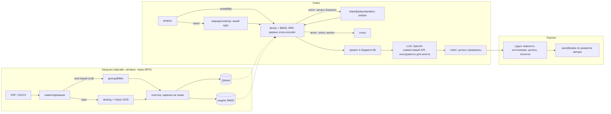

# nsu-rag-llm

Вопросно-ответная система на RAG по учебным материалам ФИТ НГУ (факультет
информационных технологий Новосибирского государственного университета).
Задаёшь вопрос — сервис находит нужные страницы нужной методички и отвечает по
ним, подкрепляя каждое утверждение ссылкой вида `[курс · «документ» · с. 34]`.

> **Статус: все фазы собраны.** Инвентаризация, парсинг и OCR, нарезка на чанки
> и инкрементальная индексация, четыре режима поиска, ответы с цитатами
> (терминал, JSON, Server-Sent Events), агент с маршрутизацией, повторным
> поиском и инструментами, LLM-судья с калибровкой по разметке автора и
> сравнение моделей — готовы, покрыты тестами и описаны в 32 записях о
> решениях. Не хватает только собственных вопросов и разметки автора для
> оценки: цифры качества ниже ждут их; стоимость и скорость уже измерены.

> **Сами учебные материалы в репозиторий не входят.** Это чужие произведения,
> защищённые авторским правом. Папка `data/` целиком в `.gitignore`, и ни одного
> фрагмента из неё нет в тестах, отчётах и примерах.

## Архитектура



## Требования

- macOS или Linux, Python 3.14, [uv](https://docs.astral.sh/uv/)
- Docker (Qdrant и, по желанию, API)
- [Ollama](https://ollama.com), запущенная нативно на хосте: на macOS у
  контейнера нет доступа к Metal, поэтому модель не должна жить в Docker

## Быстрый старт

```bash
# 1. Модель для ответов с окном контекста, зафиксированным на 8192 токенах
ollama pull qwen3.5:9b
ollama create qwen3.5-9b-8k -f ollama/Modelfile

# 2. Python-окружение. Поисковые модели (ml) и OCR/DOCX (ingest) — опциональные
#    extras: установка по умолчанию — это то, что нужно CI и лёгкому образу API.
uv sync --extra ml --extra ingest

# 3. Qdrant
docker compose up -d qdrant

# 4. Конфигурация
cp .env.example .env

# 5. Проверить, что всё отвечает
uv run nsu-rag health
```

Чтобы запустить API ещё и в контейнере, сначала соберите индекс нативно
(разделы ниже), затем `docker compose up --build`. Образ везёт поисковые модели
на CPU — гибридный поиск, реранкер выключен, потому что cross-encoder на CPU
слишком медленный, — монтирует `data/` только на чтение, скачивает модели в
volume при первом вопросе и обращается к Ollama на хосте по адресу
`http://host.docker.internal:11434/v1` (ADR-032).

### Обзор корпуса

```bash
uv run nsu-rag inventory                # страницы, текстовый слой, язык, копии
uv run nsu-rag inventory --benchmark    # заодно замеряет время OCR и эмбеддинга
```

Пишет `data/inventory.md` и обновляет `data/courses.yaml`, сохраняя уже
указанные в нём названия курсов и флаги `include`. Бенчмарку нужны
опциональные extras: `uv sync --extra ingest --extra ml`.

### Парсинг

```bash
uv run nsu-rag parse                    # то, что включено в courses.yaml
uv run nsu-rag parse --course os        # один курс
uv run nsu-rag parse --force            # не использовать кэш
```

Каждый документ превращается в `data/parsed/<sha256>/`: сырой вывод парсера,
очищенные страницы, которые читает индексация, и `document.md` для чтения
глазами. В `data/parse-report.md` перечислены страницы, которые стоит проверить
руками. Повторный запуск ничего не парсит; очистка каждый раз заново делается
из кэша.

PDF проходят через layout-модель `pymupdf4llm`. Выносные формулы заменяются
маркером `[формула]`, потому что текстовый слой PDF их не передаёт — кроме
случаев, когда «формула» на деле абзац обычного текста: его оставляем;
листинги кода построчно собираются обратно в блоки кода; галочки и стрелки,
набранные символьными шрифтами, восстанавливаются. Качество оценивается по
собственному текстовому слою каждой страницы: на страницах без формул парсер
сохраняет в медиане 100% текста. Почему так, с замерами, — ADR-011…019 в
[docs/decisions.md](docs/decisions.md).

### Нарезка и индексация

```bash
docker compose up -d qdrant
uv sync --extra ml                      # sentence-transformers, torch
uv run nsu-rag ingest                   # нарезать, посчитать эмбеддинги для нового, убрать исчезнувшее
uv run nsu-rag ingest --dry-run         # только нарезать и выдать отчёт
```

Чанки идут по заголовкам книги, но заголовок начинает новый чанк, только когда в
текущем набралось достаточно текста: уровни заголовков от книги к книге разные,
а пятая часть разделов короче пары предложений. Листинги и таблицы никогда не
режутся посреди строки, и каждый чанк вместе со строкой «курс › документ ›
раздел» помещается в окно эмбеддинг-модели на 512 токенов. Id чанка выводится
из его содержимого, поэтому повторный запуск ничего не пересчитывает, а правка
пересчитывает эмбеддинги только затронутых чанков. В `data/chunks.jsonl` лежат
все чанки для поиска по ключевым словам (BM25); цифры — в
`data/ingest-report.md`.

### Полный корпус

Индекс MVP содержит изначально цифровые документы пяти курсов. Всё остальное —
другие курсы, документы на английском и распознанные через OCR сканы — идёт в
отдельный индекс, чтобы одни и те же вопросы можно было задать обоим
(`corpus.full.env` задаёт охват, файл чанков и коллекцию):

```bash
uv sync --extra ml --extra ingest
uv run --env-file corpus.full.env nsu-rag ocr --status     # насколько продвинулся OCR
uv run --env-file corpus.full.env nsu-rag ocr              # часы работы; можно остановить и перезапустить
uv run --env-file corpus.full.env nsu-rag parse
uv run --env-file corpus.full.env nsu-rag ingest
uv run --env-file corpus.full.env nsu-rag eval --stage retrieval   # -> <date>-retrieval-full.md
```

OCR идёт постранично и дописывает каждую готовую страницу в кэш, поэтому
прерванный запуск теряет не больше одной страницы; затем `parse` очищает
распознанные документы вместе с остальными (ADR-030).

Полный корпус — 145 уникальных документов, 59 630 страниц, 22 курса, 130 483
чанка; 20 040 из этих страниц прошли OCR за 7,9 часа без единой ошибки, и одно
только руководство Intel по x86 — это 8% страниц. На тех же вопросах, что и
индекс MVP, полный индекс сохранил 70% их топ-10 — остальное в основном заняли
недавно распознанные учебники тех же курсов, — а гигантские руководства ни
одного из этих мест не забрали: поиск держится языка вопроса, поэтому
англоязычные руководства отвечают на английские вопросы и на вопросы с
названием инструкции, а остальные не трогают (ADR-030).

### Поиск

```bash
uv run nsu-rag search "Чем процесс отличается от потока?"            # hybrid+rerank
uv run nsu-rag search "fork" --mode bm25 --course os --k 5
```

| режим | что делает | задержка на M3 Air |
|---|---|---|
| `bm25` | поиск по ключевым словам, русские и английские слова приводятся к основе стеммером Snowball | ~1 мс |
| `dense` | эмбеддинг запроса multilingual-e5, ближайшие чанки в Qdrant | ~70 мс |
| `hybrid` | оба, объединённые через Reciprocal Rank Fusion | ~50 мс |
| `hybrid+rerank` | топ-30 гибридного поиска перечитывает cross-encoder `bge-reranker-v2-m3` | ~4 с |

`RERANKER_ENABLED=false` выключает реранкер везде.

### Оценка поиска

Автор пишет `eval/questions.jsonl` (формат и советы — в `eval/README.md`);
ничто в этом репозитории не генерирует вопросы.

```bash
uv run nsu-rag eval --stage retrieval --validate-only
uv run nsu-rag eval --stage retrieval       # recall@5, recall@10, MRR@10 для всех четырёх режимов
```

Попадание — это чанк из эталонного документа, страницы которого пересекаются с
эталонными страницами; документы сопоставляются по хешу содержимого, поэтому
можно указать любую копию дубликата. Отчёт `eval/reports/<date>-retrieval.md`
разбивает метрики по курсам, по происхождению текста (изначально цифровой,
собственный OCR-слой скана или OCR этого проекта) и по типам вопросов и
содержит только id вопросов и числа.

### Вопрос

```bash
uv run nsu-rag ask "Чем процесс отличается от потока?"
uv run nsu-rag ask "Что такое семафор?" --course os
```

Ответ печатается по мере генерации, после каждого утверждения — цитата
`[<курс> · «<документ>» · с. N]`. Затем идут процитированные источники,
проблемы с цитатами, если есть, и время каждого этапа:

```
Источники (процитировано 5 из 10):
  Ф1  [<course> · «<document>» · с. 34]  <course>/sem4/<file>.pdf
  …
поиск 107 мс · реранк 4146 мс · первый токен 40.6 с (из них модель читала промпт 36.4 с) · весь ответ 52.7 с
промпт 4494 ток. (оценка 4504) · ответ 183 ток., 15.2 ток/с
```

Что происходит между вопросом и ответом:
* гибридный поиск с реранком; лучшие 10 фрагментов попадают в промпт с метками
  `[Ф1]`…`[Ф10]` — столько, сколько помещается в окно 8 192 токена, если
  оставить 1 024 на ответ. Промпт измеряется собственным токенизатором модели
  до отправки, а не поместившийся фрагмент пишется в лог (ADR-024);
* модель ссылается на метки; код проверяет каждую и подставляет полную
  цитату, поэтому название или номер страницы никогда не выдумываются. Метка,
  за которой нет фрагмента, выводится как ошибка (ADR-025);
* если в методичках ответа нет, ответ — «В методичках этого нет.», а если поиск
  ничего не нашёл, модель вообще не вызывается (ADR-026).

### Оценка ответов и выбор модели

```bash
ollama create qwen3.5-4b-8k -f ollama/Modelfile.qwen3.5-4b     # остальные кандидаты,
ollama create gemma4-12b-8k -f ollama/Modelfile.gemma4-12b     # у каждой контекст 8k
uv run nsu-rag eval --stage generation     # все модели из eval/models.yaml, с оценкой судьёй
uv run nsu-rag eval --stage judge          # судья против вашей собственной разметки
```

Каждый вопрос ищется один раз, и все модели отвечают по одним и тем же
фрагментам, находясь в памяти по одной. Затем модель-судья (`JUDGE_*`, свой
endpoint) читает каждый ответ дважды: сверяя с фрагментами — есть ли там каждое
утверждение, подтверждает ли каждая цитата своё утверждение — и с вашим
эталонным ответом — не упущено ли что-то. Цитаты несуществующих фрагментов и
отказы считает код, а не судья (ADR-028). В отчёте
`eval/reports/<date>-generation.md` для каждой модели: верность источникам,
полнота, валидные и подтверждённые цитаты, отказы на вопросы без ответа,
ложные отказы, время до первого токена, токенов в секунду и пиковая память;
сами ответы и вердикты остаются в `data/eval-runs/`.

Насколько можно доверять судье, измеряется, а не предполагается: разметьте
часть ответов сами в `eval/manual_labels.jsonl` (формат — в `eval/README.md`),
и `--stage judge` выдаст согласие и каппу Коэна по каждому вердикту.

### Агент

```bash
uv run nsu-rag ask "Сколько сочетаний из 10 по 3?" --agent
uv run nsu-rag eval --stage agent        # конвейер фазы 3 против агента
```

Граф LangGraph вокруг конвейера фазы 3: маршрутизатор выбирает курс и
фильтрует поиск; если реранкер не находит ничего достаточно близкого, вопрос
переформулируется и ищется заново, а иначе — отказ без генерации; во время
ответа модель может вызывать `python_calc` (безопасная арифметика, без `eval`)
и `search_course_materials` (ADR-031). API принимает `"agent": true` в теле
запросов `/ask` и `/ask/stream`.

### HTTP API

```bash
uv run uvicorn nsu_rag_llm.api.main:app
curl -s localhost:8000/health | python3 -m json.tool
curl -s localhost:8000/ask -H 'content-type: application/json' \
     -d '{"question": "Чем процесс отличается от потока?", "course": "os"}' | python3 -m json.tool
curl -N localhost:8000/ask/stream -H 'content-type: application/json' \
     -d '{"question": "Чем процесс отличается от потока?"}'
```

* `/health` параллельно опрашивает Qdrant и LLM-endpoint и отвечает `503`, если
  что-то из них лежит, называя, что именно.
* `/ask` возвращает ответ, все фрагменты, которые прочитала модель (`sources`),
  какие из них процитированы, ошибки цитат, число токенов и время этапов.
* `/ask/stream` отдаёт то же через Server-Sent Events: сначала `sources`, затем
  события `token` с уже раскрытыми цитатами, затем `done` — или `error`, если
  что-то сломалось посреди ответа (ADR-027).
* `"agent": true` в теле запроса — ответ агентом (ADR-031).
* Первый вопрос загружает модели, нативно это около 20 с; схема — на `/docs`.

## Конфигурация

Каждая настройка — переменная окружения, все они с значениями по умолчанию
перечислены в `.env.example`. См. [src/nsu_rag_llm/config.py](src/nsu_rag_llm/config.py).
Параметры сэмплирования вынесены в конфигурацию, а не зашиты в Modelfile,
чтобы в фазе 4 сравнивать модели при одинаковом сэмплировании.

## Результаты

| Режим поиска | recall@5 | recall@10 | MRR@10 |
|---|---|---|---|
| BM25 | _вопросы автора_ | | |
| dense | | | |
| hybrid (RRF) | | | |
| hybrid + rerank | | | |

| Генерирующая модель | верность источникам | полнота | цитаты | отказы | TTFT | ток/с | пик RAM |
|---|---|---|---|---|---:|---:|---:|
| `qwen3.5-4b` | _вопросы автора_ | | | | 31,3 с | 10,1 | 3,25 ГБ |
| `qwen3.5-9b` (по умолчанию) | | | | | 50,5 с | 6,1 | 5,62 ГБ |
| `qwen3.5-9b`, с thinking | ответа нет: бюджет в 3 072 токена ушёл на рассуждения | | | | - | - | 5,62 ГБ |
| `gemma4-12b` | | | | | 79,1 с | 4,0 | 7,83 ГБ |

Стоимость измерена на произвольных вопросах, все модели — на одних и тех же
фрагментах, за один прогон на ноутбуке, который в тот час работал медленно: тот
же `qwen3.5-4b` утром того же дня выдавал первый токен за 18,3 с (22,6 ток/с).
Сравнивайте внутри таблицы, а не с другими прогонами (ADR-029).

## Ограничения

* **Только точечные вопросы.** Поиск top-k приносит десять фрагментов; «перескажи
  весь курс» или «перечисли все теоремы главы 3» требуют видеть курс целиком, а
  этого не даёт никакой top-k-поиск.
* **Страницы после OCR отвечают хуже.** Ошибки распознавания попадают во
  фрагменты, которые читает модель; отчёт о поиске разбивает recall по
  происхождению текста, так что разрыв измерен, а не угадан.
* **Формулы.** Там, где парсер не смог извлечь формулу, он оставляет
  `[формула]` (ADR-012), и модели сказано её не восстанавливать — но в
  smoke-прогоне фазы 3 она однажды выписала (верную) формулу, которой не было в
  её фрагментах. Судья считает это неверностью источникам.
* **Задержка на ноутбуке с 16 ГБ.** Сервер модели и процесс поиска вместе
  занимают около 13 ГБ; с открытыми приложениями или на почти разряженной
  батарее первое слово может появиться через минуту (ADR-026, ADR-029).
* **Русские вопросы редко доходят до английских документов.** Поиск держится
  языка вопроса: русский вопрос об адресации в x86 не нашёл ни одного
  английского фрагмента, тот же вопрос на английском нашёл десять (ADR-030).
* **Рукописные конспекты не распознаются.** Vision читает печатный текст;
  рукописные конспекты лекций выходят почти пустыми, и отчёт парсинга
  перечисляет их страницы.
* **Нативно или в контейнере, но не оба сразу рядом с долгими задачами.**
  Контейнер загружает свою копию поисковых моделей на CPU; на ноутбуке с 16 ГБ,
  где уже шёл OCR, его VM исчерпала память на первом вопросе. На свободной
  машине он ответил за минуту, первый вопрос — ещё на две минуты дольше из-за
  загрузки моделей (ADR-032).
* **Судья — модель на 9B**, по умолчанию та же, что отвечает; её согласие с
  человеком измеряется калибровкой, а не предполагается (ADR-028).
* **Цифр качества пока нет.** Вопросы и разметку, по которым измеряется
  качество, пишет автор, и ничто здесь их не генерирует.
* **Только для личного использования.** Учебные материалы — чужие
  произведения; их нет в этом репозитории, и ничего производного от них нет в
  его отчётах, тестах и примерах.

## Что бы я сделал дальше

* **Сначала измерить, потом настраивать** — на вопросах автора: реранкер
  включён или выключен, сколько кандидатов он читает, сколько фрагментов
  получает модель и порог отказа агента, каждое — против recall и верности
  источникам.
* **Восстановить формулы.** Проход распознавания формул (LaTeX OCR по областям,
  которые layout-модель пометила как формулы) заменил бы `[формула]` самой
  формулой — и убрал бы у модели соблазн подставить свою.
* **Поиск между языками:** второй поиск с переведённым на английский вопросом,
  объединённый так же, как BM25 и dense, открыл бы англоязычные руководства для
  русских вопросов.
* **Потоковый ответ агента** — отделить раунды с инструментами от финального
  потокового вызова.
* **Дешёвый маршрутизатор:** небольшой классификатор поверх эмбеддинга вопроса
  вместо вызова модели на 9B, обученный на размеченных вопросах автора.
* **Дообучить реранкер** на трудных отрицательных примерах из вопросов автора:
  страницах, которые выглядят релевантными, но не являются ими.

## Разработка

```bash
uv run ruff check .
uv run ruff format .
uv run pytest
```

Тестам не нужны ни сеть, ни GPU, ни запущенная LLM, ни сами учебные материалы —
все внешние компоненты подменены фейками.

Проектные решения, включая отвергнутые альтернативы, записаны в
[docs/decisions.md](docs/decisions.md).
