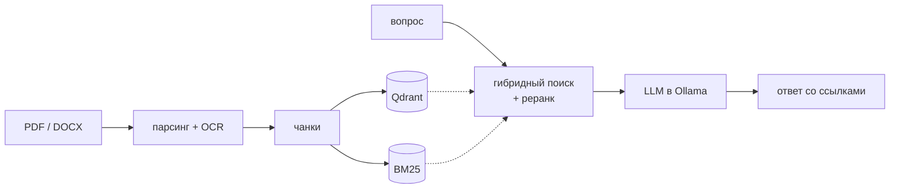

# nsu-rag-llm

Вопросно-ответная система по учебным материалам ФИТ НГУ: отвечает по
методичкам и к каждому утверждению ставит ссылку `[курс · «документ» · с. 34]`.

**Русский** · [English](README.en.md)

## Зачем

Методичек много, и они разбросаны: десятки PDF, часть из них сканы. Найти,
где именно объясняется семафор или формула Байеса, долго, а ответ ChatGPT
без источника нельзя проверить. Здесь ответ строится только по
материалам курса, и каждую фразу можно открыть на нужной странице.

## Что умеет

- парсит PDF и DOCX, сканы распознаёт через OCR: 59 630 страниц, 22 курса
- гибридный поиск: BM25 + эмбеддинги, слияние RRF, реранк cross-encoder'ом
- ответ со ссылками на страницы, в терминале, в JSON и потоком (SSE)
- агент: выбирает курс, переформулирует запрос, честно отказывает, если ничего не нашёл
- LLM-судья для оценки ответов, сверенный с ручной разметкой
- всё работает локально на Ollama, без внешних API

## Как устроено



| Поиск | Задержка на M3 Air |
|---|---|
| BM25 | ~1 мс |
| эмбеддинги (multilingual-e5) | ~70 мс |
| гибридный | ~50 мс |
| гибридный + реранк | ~4 с |

Сами учебные материалы в репозиторий не входят: это чужие тексты под
авторским правом.

## Стек

Python 3.14 · uv · Qdrant · Ollama (Qwen) · LangGraph · sentence-transformers · pymupdf4llm · docling · FastAPI · Typer · pytest

## Структура

```
src/nsu_rag_llm/
  ingest/       инвентаризация, парсинг, OCR, нарезка, индексация
  retrieval/    BM25, эмбеддинги, RRF, реранк
  generation/   промпт, LLM, проверка ссылок
  agent/        маршрутизация и повторный поиск
  evaluation/   метрики поиска и LLM-судья
  api/          HTTP API
  cli.py        команды nsu-rag
eval/           шаблоны вопросов и разметки
ollama/         Modelfile для моделей
tests/          тесты, всё внешнее подменено
```

## Запуск

```bash
ollama pull qwen3.5:9b && ollama create qwen3.5-9b-8k -f ollama/Modelfile
uv sync --extra ml --extra ingest
docker compose up -d qdrant
cp .env.example .env

uv run nsu-rag parse && uv run nsu-rag ingest
uv run nsu-rag ask "Чем процесс отличается от потока?"
```

HTTP API: `uv run uvicorn nsu_rag_llm.api.main:app`, затем `POST /ask` или `/ask/stream`.
Тесты: `uv run pytest`.

P.S. Пока запускается локально через localhost.
